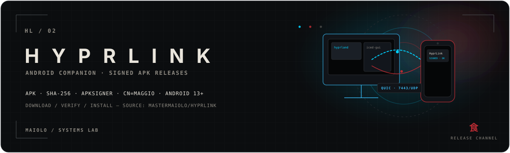

<!-- MAIOLO / SYSTEMS LAB — HYPRLINK ANDROID -->

<p align="center">
  
</p>

<p align="center"><sub><strong>ANDROID 13+ · CÓDIGO-FONTE · APK ASSINADO · SHA-256 · APKSIGNER · CN=MAGGIO</strong></sub></p>

<p align="center">
  <a href="README.md">🇬🇧 English (UK)</a>
  · <a href="README.pt-br.md">🇧🇷 Português (BR)</a>
  · 🇵🇹 <strong>Português (PT)</strong>
  · <a href="README.es-es.md">🇪🇸 Español (ES)</a>
  · <a href="README.zh-cn.md">🇨🇳 简体中文</a>
</p>

> Este repositório aloja o código-fonte completo e as versões oficiais (pacotes APK assinados) da aplicação **HyprLink** para Android.

O daemon Linux para Hyprland, a interface de linha de comandos (CLI), a GUI de desktop e as especificações de protocolo estão alojados no repositório principal:
👉 **[mastermaiolo/hyprlink](https://github.com/mastermaiolo/hyprlink)**

---

## 01 / VISÃO GERAL

| | |
|---|---|
| **O quê** | Código-fonte da app Android e APKs assinados de lançamento |
| **Emparelha com** | O daemon HyprLink em Linux/Hyprland, mesma versão |
| **Android mínimo** | 13 |
| **Assinante** | `CN=Maggio` |
| **Transferências** | [Releases](https://github.com/mastermaiolo/hyprlink-android/releases/latest) — `.apk` + `.sha256` correspondente |

---

## 02 / INSTALAÇÃO

### Via Obtainium (Recomendado)
Adiciona este repositório diretamente no [Obtainium](https://github.com/ImranR98/Obtainium) para instalar e receber atualizações automáticas dos lançamentos oficiais:
```text
https://github.com/mastermaiolo/hyprlink-android
```

### Via ADB / Transferência Manual
1. Transfere o ficheiro `.apk` e o respetivo `.sha256` da secção de [Releases](https://github.com/mastermaiolo/hyprlink-android/releases/latest).
   ```bash
   R=mastermaiolo/hyprlink-android
   gh release download "$(gh release list -R $R -L 1 --json tagName -q '.[0].tagName')" -R $R -p 'hyprlink-*.apk*'
   ```
2. Podes instalar no teu telemóvel através de ADB no terminal:
   ```bash
   adb install -r hyprlink-*.apk
   ```
   Ou transferir o ficheiro diretamente para o dispositivo móvel e abri-lo através do gestor de ficheiros (autorizando a instalação de pacotes a partir dessa fonte).

---

## 03 / COMPILAR

A aplicação é compilada com as ferramentas padrão do Android Gradle (JDK 21+, Android SDK 33–36).
Para instruções completas e pré-requisitos, consulta o guia [`BUILDING.md`](BUILDING.md).
Sem variáveis de ambiente de assinatura, o comando `./gradlew assembleRelease` gera um APK de release limpo não assinado (`hyprlink-*-unsigned.apk`).

---

## 04 / VERIFICAÇÃO DE INTEGRIDADE E ASSINATURA

Para garantir a segurança e proveniência do binário:

1. **Verificação do checksum (SHA-256):**
   ```bash
   sha256sum -c hyprlink-*.apk.sha256
   ```

2. **Verificação da assinatura oficial (apksigner):**
   Utilizando a ferramenta `apksigner` do Android SDK Build-Tools:
   ```bash
   apksigner verify --print-certs hyprlink-*.apk
   ```
   Deverás confirmar nos dados do certificado:
   ```text
   Signer #1 certificate DN: CN=Maggio
   ```

<details>
<summary><strong>Impressão digital do certificado (SHA-256)</strong></summary>

```text
96:95:EF:25:82:CB:6C:62:28:5A:18:0A:BB:1A:A5:6C:1A:B7:AB:48:D4:16:79:55:F3:8E:79:FB:09:99:44:D4
```

</details>

---

## 05 / REQUISITOS E LIMITAÇÕES CONHECIDAS

- Android 13 ou superior; a mesma versão do HyprLink no PC ([mastermaiolo/hyprlink](https://github.com/mastermaiolo/hyprlink)).
- Desde o Android 10, uma app só pode ler a área de transferência quando está aberta: um texto copiado no telemóvel é enviado para o PC quando abres o HyprLink.
- Em ROMs Xiaomi/HyperOS/MIUI, confirma nas definições da app: arranque automático, sem restrições de bateria e «ler a área de transferência».
- Transferências em paralelo ainda não são suportadas: os envios ficam em fila.
- A ligação por cabo USB continua em teste.

As novidades de cada versão estão em cada [release](https://github.com/mastermaiolo/hyprlink-android/releases).

---

## 06 / COMO FOI FEITO

Esta aplicação foi desenvolvida com assistência contínua de inteligência artificial (iniciada como protótipo no Google AI Studio e posteriormente desenvolvida e refinada em conjunto com agentes de IA), sob a direção arquitetural, especificação rigorosa e revisão de código do autor (Maggio).

Todo o código segue padrões nativos de Kotlin e Jetpack Compose, sem recurso a frameworks híbridas ou telemetria, encontrando-se licenciado sob a GPL-3.0 para total transparência e auditoria aberta.

---

## 07 / PROVENIÊNCIA

Compilado e assinado por Maggio.
Código-fonte da app: este repositório; daemon Linux, protocolo e CLI: [mastermaiolo/hyprlink](https://github.com/mastermaiolo/hyprlink).
Política de segurança e reporte privado de vulnerabilidades: [`SECURITY.md`](SECURITY.md).

---

## 08 / LICENÇA

**GPL-3.0-or-later** — ver [`LICENSE`](LICENSE) e [`THIRD_PARTY.md`](THIRD_PARTY.md).

---

<p align="center"><sub>MAIOLO / SYSTEMS LAB · HYPRLINK · HL / 02 · 食</sub></p>
